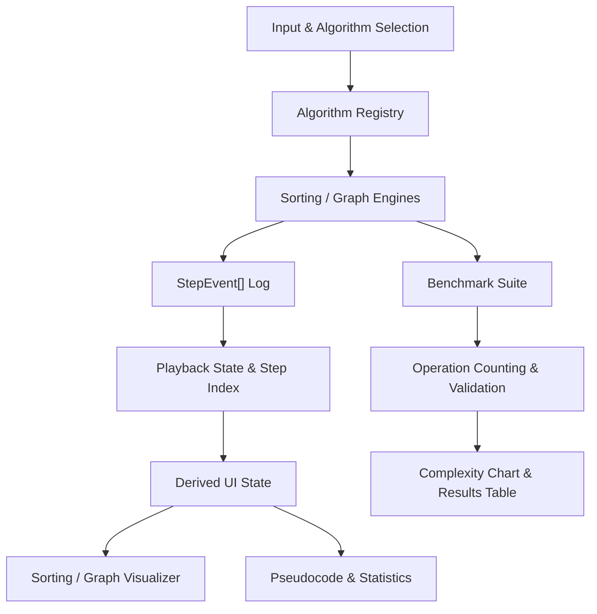

# Algorithm Visualizer & Complexity Analyzer

An interactive application for exploring sorting and graph algorithms through step-by-step visualization, synchronized pseudocode, and complexity analysis.

Built with **React, TypeScript, Vite, and Tailwind CSS**, the application brings together algorithm execution, playback, side-by-side comparison, and empirical operation benchmarking.

I developed this project to understand algorithms beyond their final outputs: how operations unfold, how intermediate states change, and how computational work varies with different inputs.

---

## Overview

The application has four workspaces:

| Workspace | Purpose |
| --- | --- |
| **Sorting** | Visualize and control six sorting algorithms |
| **Graph** | Explore five graph traversal and pathfinding algorithms |
| **Compare** | Run two sorting algorithms against the same input |
| **Complexity** | Compare instrumented operations with theoretical complexity growth |

## Features

### Sorting Visualizer

**Algorithms:** Bubble Sort, Selection Sort, Insertion Sort, Merge Sort, Quick Sort, and Heap Sort.

- Animated bars with distinct comparison, swap/write, pivot, and sorted states
- Play, pause, reset, step forward, step backward, and adjustable speed
- Random, sorted, reverse, nearly sorted, few-unique, and custom datasets
- Configurable Quick Sort pivot strategies
- Live comparisons, data operations, execution progress, and pseudocode highlighting
- Explanations covering algorithm behavior, complexity, and applications

### Graph Visualizer

**Algorithms:** Breadth-First Search (BFS), Depth-First Search (DFS), Dijkstra's Algorithm, A* Search, and Bellman-Ford.

- SVG-based nodes, edges, and edge-weight labels
- Default, random, and custom graph inputs
- Start-node selection and goal-node selection for A*
- Step-by-step node discovery, visitation, relaxation, and path visualization
- Synchronized pseudocode and execution descriptions
- Negative-weight validation for Dijkstra and A*
- Reachable negative-cycle detection with Bellman-Ford

### Compare Mode

- Two sorting algorithms run against the **same original array**
- Independent playback positions controlled through shared actions
- Separate bars, pseudocode, and operation counters
- Results summary with comparisons, data operations, visualization steps, and theoretical complexity
- Recorded comparison counts rather than assumptions about wall-clock speed

### Complexity Analyzer

- Select and overlay multiple algorithm curves
- Toggle between **Real Run** and **Theoretical** views
- Execute the real sorting and graph engines at deterministic input sizes
- Inspect benchmark outcomes, operation counts, and a detailed results table
- Validate sorting results and graph executions against independent reference checks

### Interface

- User-controlled light and dark mode toggle
- Consistent layouts, shared controls, legends, and information panels
- Responsive visualizations and interactive SVG/chart displays

---

## Architecture

The application separates **algorithm execution** from **visual presentation**. Each engine returns a sequence of typed `StepEvent[]` records. React uses those events and the current playback position to render the visual state, pseudocode, and statistics.



### Event Data Contract

The application uses a shared TypeScript event structure with a type discriminator and optional payloads. A simplified representation is:

```typescript
type StepEvent = {
  type: StepEventType
  indices?: number[]
  nodeIds?: string[]
  edge?: { from: string; to: string; weight?: number }
  values?: number[]
  pseudocodeLine: number
  description: string
}
```

For example, a sorting engine can emit a swap event:

```typescript
{
  type: 'swap',
  indices: [2, 3],
  pseudocodeLine: 5,
  description: 'Swapping two array elements'
}
```

Graph events can instead carry `nodeIds` and an `edge`. This common contract keeps execution logic separate from how operations are displayed.

### Playback and State Reconstruction

The sorting player derives visible bars and operation counts from the **original array** and the events through `currentStepIndex`. It replays swaps, shifts, and overwrites whenever the selected step changes. The application does **not** store a complete array snapshot for every step.

For input length `N` and `K` replayed events, the current implementation takes approximately **O(N × K)** time in the worst case because it resets bar highlights across the array for each event; its additional working space is **O(N)**, excluding the recorded event log.

This approach makes backward stepping straightforward without running the sorting algorithm again.

---

## Tech Stack

| Technology | Where and why it is used |
| --- | --- |
| React 19 | Component-based interfaces and interactive playback state |
| TypeScript | Typed algorithm contracts, events, and component props |
| Vite | Local development and production builds |
| Tailwind CSS 4 | Layout, styling, and responsive UI utilities |
| CSS variables | Consistent light and dark theme presentation |
| Native SVG | Graph nodes, weighted edges, and visual highlighting |
| React Hooks | Playback lifecycle, derived state, and memoization |
| Git & GitHub | Version control and source hosting |
| Vercel | Hosting the live frontend application |

The application runs in the browser and requires no backend or database.

---

## Complexity Analysis and Benchmarking

The **Theoretical** view presents asymptotic growth functions such as `O(N)`, `O(N log N)`, `O(N²)`, `O(V + E)`, `O(V² + E)`, and `O(VE)`.

The **Real Run** view counts recorded operations from actual executions, using fixed, reproducible inputs:

| Category | Input sizes |
| --- | --- |
| Sorting | `10`, `25`, `50`, `100` elements |
| Graph | `5`, `10`, `20`, `40` vertices |

Sorting benchmarks count comparisons and recorded swaps, shifts, and overwrites. Graph benchmarks count emitted comparison, visit, discovery, and relaxation events.

Validation checks include sorting against a correctly sorted reference array, traversal reachability, and shortest-path checks for Dijkstra, A*, and Bellman-Ford on the benchmark graphs.

**Recorded operations, animation steps, theoretical growth, and elapsed execution time are different measurements.** This project compares the first three; it does not treat visualization steps as CPU time or claim every event represents the same computational cost.

---

## Project Structure

```text
src/
├── algorithms/
│   ├── sorting/              # Six sorting engines
│   ├── graph/                # Five graph engines and utilities
│   ├── benchmark/            # Benchmark runners and validation
│   └── data/                 # Presets and educational descriptions
├── components/               # Shared visualizers and UI controls
│   ├── AlgoSelector.tsx
│   ├── Controls.tsx
│   ├── SortVisualizer.tsx
│   ├── GraphVisualizer.tsx
│   ├── PseudocodePanel.tsx
│   ├── InformationPanel.tsx
│   ├── CompareMode.tsx
│   └── ResultSummary.tsx
├── screens/
│   ├── SortingScreen.tsx
│   ├── GraphScreen.tsx
│   └── ComplexityScreen.tsx
├── hooks/
│   └── useStepPlayer.ts
├── contexts/
│   └── ThemeContext.tsx
├── types/
│   └── index.ts
├── App.tsx
├── main.tsx
└── index.css
```

`App.tsx` coordinates the four workspaces. Algorithm engines, playback logic, and presentation components have separate responsibilities.

---

## Getting Started

### Prerequisites

- Node.js compatible with the Vite version in `package.json`
- npm

### Install and run

```bash
git clone https://github.com/Sree-2607/Algorithm-Visualiser-and-Complexity-Analyser.git
cd Algorithm-Visualiser-and-Complexity-Analyser
npm install
npm run dev
```

Open the local URL printed by Vite.

### Build and validate

```bash
npm run lint
npm run build
npm run preview
```

---

## Future Improvements

- Additional algorithm categories, such as trees and dynamic programming
- More benchmark input distributions and larger datasets
- Improved graph layouts for larger custom networks

---

## Live Application

[Algorithm Visualizer & Complexity Analyzer](https://algorithm-visualiser-and-complexity.vercel.app/)
